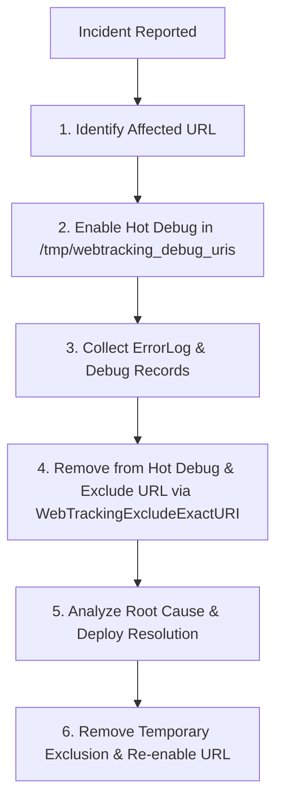

# 📘 Web Tracking Apache Module

## 📌 Overview

The **Web Tracking Apache Module** (`mod_web_tracking`) is a high-performance plugin designed for **Apache Web Server 2.4.x** and derived products such as **IBM HTTP Server 9.0.x**, running on 64-bit Linux architectures.

### 📋 At a Glance

| Property | Value |
|---|---|
| **Web Server** | Apache Web Server 2.4.x / IBM HTTP Server (IHS) 9.0.x |
| **Architecture** | 64-bit |
| **Certified OS** | Red Hat Enterprise Linux (RHEL) 8.x and 9.x |
| **Tracked Protocol** | **HTTP/1.1 only** *(requests using other protocol versions are ignored)* |
| **Source Language** | C17 / C++23 specifications |
| **Compiler** | GCC 15.1.1 20250521 (Red Hat 15.1.1-2) |
| **Module Binary** | `mod_web_tracking.so` |
| **Distribution Package** | `webtracking-bin.zip` |
| **Documented Version** | `2026.10.30.1` |
| **Storage Destination** | Staged in `WebTrackingRecordFolder`, archived to `WebTrackingRecordArchiveFolder` |

---

### 🔍 Main Functionality & Dual Purpose

The primary function of the module is to track input (requests) and output (responses) of HTTP/HTTPS roundtrips inside the web server.

1. **Legal & Security Control**: Complete auditing and tracking of HTTP transactions for regulatory compliance and forensic investigations.
2. **Debugging**: Diagnostic tracing for anomalous web transactions or unpredictable application behavior.

> ⚠️ **Protocol Restriction**: Only **HTTP/1.1** is tracked. Requests using HTTP/2, HTTP/3, or HTTP/1.0 are skipped.  
> 📦 **Compression**: Built-in proprietary extension of **zlib v1.2.11** (compiled statically within the module for portability and security). Supports **gzip** and **deflate**.  
> 🛡️ **Security Management**: The module logs and filters traffic; it does not perform threat detection or WAF mitigation.

---

## ⚙️ Requirements

### 📁 File System & Ownership Prerequisites

To ensure proper operation and permissions:

- **Directory Ownership**: Output directories must be owned by the user who starts the main Apache/IHS process.
- **Group Ownership**: Output directories must be owned by the group defined by the Apache `Group` directive.
- **Search/Execute Permissions**: Output directories and all parent directories must grant execute (`x`) permission to both the web server user and group.
- **Filesystem**: Output and archive directories must reside on the **same Linux filesystem** (preferably **ext4**).

### 🔒 SELinux Prerequisites (Enforcing Mode)

When SELinux is active in `enforcing` mode:

- Output directories must have the `httpd_sys_rw_content_t` context type:
  ```bash
  semanage fcontext -a -t httpd_sys_rw_content_t "/webtracking/logs(/.*)?"
  restorecon -Rv /webtracking/logs
  ```
- The module binary directory must have the `httpd_modules_t` context type:
  ```bash
  semanage fcontext -a -t httpd_modules_t "/webtracking/lib(/.*)?"
  restorecon -Rv /webtracking/lib
  ```
- The standard `/dev/shm` shared-memory directory must exist and be accessible.

---

### 🖥️ Workload & Hardware Sizing

Resource guidelines based on the volume of tracked hits per hour:

| Load (Hits / Hour) | Storage Size | RAM | CPU Sockets |
|---|---|---|---|
| **> 15,000,000** | 100 GB | 20 GB | 16 |
| **> 12,500,000** | 80 GB | 16 GB | 12 |
| **> 10,000,000** | 60 GB | 12 GB | 8 |
| **> 7,500,000** | 40 GB | 8 GB | 6 |
| **> 5,000,000** | 25 GB | 6 GB | 4 |
| **< 5,000,000** | 15 GB | 4 GB | 2 |

> 🚨 **Storage Warning**: For workloads exceeding **10 million hits/hour**, placing output directories on a **dedicated filesystem** is strongly recommended to prevent root or shared disk exhaustion.

---

### ⚙️ Apache MPM Tuning

To maintain web server stability and prevent frequent worker process restarts:

#### `mpm_worker` Configuration Example

```apache
# ThreadLimit: maximum setting of ThreadsPerChild
ThreadLimit          400
# ServerLimit: maximum setting of StartServers (slack space after 9.0.0.3)
ServerLimit            4
# StartServers: initial number of server processes
StartServers           1
# MaxClients / MaxRequestWorkers: maximum simultaneous client connections
MaxClients          1600
# MinSpareThreads: minimum worker threads kept spare
MinSpareThreads       40
# MaxSpareThreads: maximum worker threads kept spare (PI74200: discourage process termination)
MaxSpareThreads      540
# ThreadsPerChild: constant worker threads per child process
ThreadsPerChild      400
MaxRequestWorkers   1600
# MaxRequestsPerChild: 0 avoids process churn
MaxRequestsPerChild    0
ListenBacklog       2048
MaxMemFree          4096
```

> For **`mpm_event`**, default settings are generally sufficient.

---

## 🌟 Features & Capabilities

1. **Global Disable / Enable**: Disable tracking globally or operate in statistical-only mode.
2. **Unique Correlation ID**: Automatically generate and inject a unique tracking UUID header into requests.
3. **URL Pattern Matching**: Match full incoming URLs via Perl Compatible Regular Expressions (PCRE).
4. **URI Inclusion / Exclusion**: Target or ignore specific URI prefixes, exact URIs, or regex patterns.
5. **HTTP Method Filtering**: Exclude specific HTTP methods (e.g., `OPTIONS`, `HEAD`).
6. **HTTP Status Code Filtering**: Exclude specific HTTP response codes (e.g., `404`).
7. **Disabling Request Headers**: Disable tracking dynamically when specific request headers are detected.
8. **Disabling Response Headers**: Conditionally cancel tracking if response headers match specific regex values.
9. **Virtual Host Filtering**: Enable tracking for specific hosts or regular expressions.
10. **Proxy & Real Client IP**: Detect real client IP addresses behind reverse proxies via configurable headers.
11. **SSL Offloading Support**: Detect upstream HTTPS termination via custom indicator headers.
12. **Header Redaction & Exclusion**: Suppress sensitive headers or redact their values from tracking records.
13. **Cookie Sanitization**: Strip specific cookies from `Cookie`, `Cookie2`, `Set-Cookie`, and `Set-Cookie2` headers.
14. **POST Form Parameter Redaction**: Exclude specific form variables or all parameters from `application/x-www-form-urlencoded` payloads.
15. **Payload Tracking Control**: Granularly control request/response body capture (`Always`, `Never`, `Content`).
16. **MIME Type Whitelisting**: Selectively capture bodies matching specific Content-Types via PCRE regex.
17. **Payload Size Guard**: Enforce maximum body size limits (1–100 MB, default 5 MB).
18. **Gzip Inflation**: Inflate gzip-compressed response bodies for plaintext logging.
19. **Response Header Extraction**: Remove headers from client responses while capturing them in tracking records (`WebTrackingOutputHeader`).
20. **Environment Variable Logging**: Capture Apache environment variables with the `ENV:` prefix.
21. **Automated File Rotation & Archival**: Rotate record files by time window (5–120 min) or file size (> 1 GB), moving closed files to an archive directory.
22. **Hot Debugging**: Enable runtime debug logging for specific URIs without restarting Apache.
23. **Metrics Logging**: Output structured performance records (`[WT-METRICS: ...]`) to the web server `ErrorLog`.
24. **Server Status Integration**: Display live module statistics, version details, and active log file on `/server-status`.
25. **SELinux Compatibility**: Fully certified under SELinux `enforcing` mode.
26. **Non-Root Execution**: Supports running under unprivileged user/group accounts.

---

### 🧾 Special Headers

- **UUID Tracking Header**: Injected into each request (configured via `WebTrackingUuidHeader`, defaults to `X-WT-UUID`).
  - Total length is **65 characters**: 64 hexadecimal characters (SHA-256 hash) + 1 circular counter character (`0` on origin; incremented through `1`-`9`, `A`-`Z`, `a`-`z` if forwarded through multiple tiers).
- **Sentinel Header**: `x-wt-request-to-be-tracked` is injected into the request headers whenever tracking is active.

### 📊 Statistical Mode (`WebTrackingDisable On`)

When `WebTrackingDisable` is set to `On`:
- The module runs exclusively in **statistical mode**, collecting request counters without writing tracking records.
- Folder directives (`WebTrackingRecordFolder`, `WebTrackingRecordArchiveFolder`) are syntactically validated but ignored.

---

## 🏷️ Version Inspection

### Documented Version
**Web Tracking Apache Module `2026.10.30.1` (C17/C++23)**

To inspect the binary version on Linux:

```bash
strings /prod/webtracking/lib/mod_web_tracking.so | grep -E -o 'Web Tracking Apache Module .*?\)'
```

The version is also printed to the Apache `ErrorLog` on server startup and displayed on the Apache `server-status` page.

---

## 🛠️ Configuration Directives Reference

All directives begin with the `WebTracking` prefix. Multi-line directives can be declared multiple times.

| Directive | Syntax | Description | Example | Req | Introduced |
|---|---|---|---|:---:|---|
| **`WebTrackingApplicationId`** | `String String [String]` | Maps a URI prefix to an Application ID, with optional case-insensitive host filter (default `*`). Most specific match wins. | `WebTrackingApplicationId /myroot MyApplication` | No | 1.0.0 (host filter: 1.1.1) |
| **`WebTrackingApplicationIdFromHeader`** | `String` | Specifies a response header whose value defines the Application ID. Unique per instance. | `WebTrackingApplicationIdFromHeader application-id` | No | 2023.9.26.1 |
| **`WebTrackingBodyLimit`** | `Number` | Maximum body size to track in MB (range: 1–100, default: 5 MB). | `WebTrackingBodyLimit 10` | No | 1.0.0 |
| **`WebTrackingClientIpHeader`** | `String` | Header containing the real client IP behind proxies (case-insensitive, default `X-Forwarded-For`). Unique per instance. | `WebTrackingClientIpHeader ClientIp` | No | 1.0.0 |
| **`WebTrackingConfigVersion`** | `String` | User-defined configuration version label, displayed in server-status. Unique per instance. | `WebTrackingConfigVersion 16.0.1` | No | 2025.5.15.1 |
| **`WebTrackingContentType`** | `PCRE` | Regex specifying Content-Types eligible for body tracking (matched against request/response `Content-Type`). Multi-line. | `WebTrackingContentType html\|json` | No | 1.0.0 |
| **`WebTrackingDisable`** | `On \| Off` | Globally disables tracking; switches module to statistical mode. | `WebTrackingDisable On` | No | 1.0.0 |
| **`WebTrackingDisablingHeader`** | `String...` | Header names that disable tracking if present in the request. Must start with `X-WT-` or `WT-` (case-insensitive). Multi-line. | `WebTrackingDisablingHeader X-WT-TR-OFF X-WT-TR-NO` | No | 1.0.0 (WT- prefix: 2025.2.5.1) |
| **`WebTrackingEnableProxy`** | `On \| Off` | Enables client IP extraction from proxy headers (`X-Forwarded-For` or `WebTrackingClientIpHeader`). | `WebTrackingEnableProxy On` | No | 1.0.0 |
| **`WebTrackingExactHost`** | `String` | Enables tracking for exact Host header values (including port if specified). Multi-line. | `WebTrackingExactHost www.mycompany.com` | No | 2025.4.7.1 |
| **`WebTrackingExactURI`** | `String` | Enables tracking for exact URI paths. Multi-line. | `WebTrackingExactURI /my-root/home` | No | 2025.3.5.1 |
| **`WebTrackingExcludeCookie`** | `String...` | Cookie names to redact from `Cookie`, `Cookie2`, `Set-Cookie`, `Set-Cookie2`. Multi-line. | `WebTrackingExcludeCookie JSESSIONID` | No | 1.0.1 |
| **`WebTrackingExcludeExactURI`** | `String` | Disables tracking for exact URI paths. Multi-line. | `WebTrackingExcludeExactURI /my-root/private/` | No | 2025.4.7.1 |
| **`WebTrackingExcludeFormParameter`** | `String...` | Form parameters to remove from POST bodies (`application/x-www-form-urlencoded`). Use `*` to disable all form params or as trailing wildcard. Multi-line. | `WebTrackingExcludeFormParameter j_password secure*` | No | 1.0.2 |
| **`WebTrackingExcludeHeader`** | `String...` | Header names to remove from request and response tracking records (case-insensitive). Multi-line. | `WebTrackingExcludeHeader SecureHeader` | No | 1.0.0 |
| **`WebTrackingExcludeHeaderValue`** | `String...` | Redacts header values in tracking records, preserving only header names (case-insensitive). Multi-line. | `WebTrackingExcludeHeaderValue Set-Cookie` | No | 1.0.0 |
| **`WebTrackingExcludeIP`** | `PCRE` | Regex of client source IPs to exclude from tracking. Multi-line. | `WebTrackingExcludeIP ^192\.168\.22` | No | 1.0.0 |
| **`WebTrackingExcludeMethod`** | `String...` | HTTP request methods to exclude from tracking. Multi-line. | `WebTrackingExcludeMethod OPTIONS HEAD` | No | 2026.9.22.1 |
| **`WebTrackingExcludeResponseHeader`** | `String PCRE` | Disables tracking if specified response header matches the given regex pattern. Multi-line. | `WebTrackingExcludeResponseHeader X-WT-USER ^ABCDEF` | No | 2026.4.28.1 |
| **`WebTrackingExcludeStartsWithURI`** | `String` | Disables tracking for URIs starting with the specified prefix. Multi-line. | `WebTrackingExcludeStartsWithURI /my-root/` | No | 2025.4.7.1 |
| **`WebTrackingExcludeStatusCode`** | `Integer...` | HTTP status codes to exclude from tracking. Multi-line. | `WebTrackingExcludeStatusCode 404 304` | No | 2026.9.22.1 |
| **`WebTrackingExcludeURI`** | `PCRE` | Regex of URIs to exclude from tracking. Multi-line. | `WebTrackingExcludeURI \.(pdf\|jpg\|css\|png)$` | No | 1.0.0 |
| **`WebTrackingExcludeURIBody`** | `PCRE` | Regex of URIs for which request and response body tracking is disabled. Multi-line. | `WebTrackingExcludeURIBody j_security_check$` | No | 1.0.0 |
| **`WebTrackingExcludeURIRequestBody`** | `PCRE` | Regex of URIs for which request body tracking is disabled. Multi-line. | `WebTrackingExcludeURIRequestBody ^/secureinput/` | No | 2025.5.12.1 |
| **`WebTrackingExcludeURIResponseBody`** | `PCRE` | Regex of URIs for which response body tracking is disabled. Multi-line. | `WebTrackingExcludeURIResponseBody no_response_body$` | No | 2025.5.12.1 |
| **`WebTrackingHost`** | `PCRE` | Case-insensitive regex of Host header values that enable tracking. Multi-line. | `WebTrackingHost \.my-company\.com$` | No | 1.0.0 |
| **`WebTrackingInflateResponse`** | `On \| Off` | Forces inflation (decompression) of gzip-compressed responses before saving to records. | `WebTrackingInflateResponse On` | No | 1.0.0 |
| **`WebTrackingOutputHeader`** | `String...` | Response headers to record in tracking logs but strip from the client response. Must start with `X-WT-` or `WT-` (case-insensitive). Multi-line. | `WebTrackingOutputHeader X-WT-USER` | No | 1.0.0 (WT- prefix: 2025.2.5.1) |
| **`WebTrackingPrintEnvVar`** | `String...` | Apache environment variables to append to the HEADERS block with `ENV:` prefix. Multi-line. | `WebTrackingPrintEnvVar WAS` | No | 1.0.6 |
| **`WebTrackingRecordArchiveFolder`** | `Path` | Directory where closed tracking log files are moved. Defaults to `<RecordFolder>/archives`. Must reside on the same filesystem as `RecordFolder`. | `WebTrackingRecordArchiveFolder /webtracking/splunk` | No | 2024.5.21.1 |
| **`WebTrackingRecordFolder`** | `Path` | Working directory where active tracking log files are written. Defaults to web server root. Must reside on the same filesystem as `RecordArchiveFolder`. | `WebTrackingRecordFolder /webtracking/logs` | No | 2024.5.21.1 |
| **`WebTrackingRecordLifeTime`** | `Number` | Time in minutes a log file accepts records before rotation (range: 5–120 min, default: 30 min). Files rotate immediately if they exceed 1 GB. | `WebTrackingRecordLifeTime 15` | No | 2024.5.21.1 |
| **`WebTrackingRequestBodyType`** | `Content \| Always \| Never` | Policy for request body capture (`Content` checks Content-Type & BodyLimit; `Always` forces capture; `Never` disables). Case-insensitive. Unique (last wins). Default: `Content`. | `WebTrackingRequestBodyType Always` | No | 2025.5.12.1 |
| **`WebTrackingResponseBodyType`** | `Content \| Always \| Never` | Policy for response body capture (`Content` checks Content-Type & BodyLimit; `Always` forces capture; `Never` disables). Case-insensitive. Unique (last wins). Default: `Content`. | `WebTrackingResponseBodyType Never` | No | 2025.5.12.1 |
| **`WebTrackingStartsWithURI`** | `String` | Enables tracking for URIs starting with the specified prefix. Multi-line. | `WebTrackingStartsWithURI /my-root/` | No | 2025.3.25.1 |
| **`WebTrackingTraceURI`** | `PCRE` | Forces request and response body tracking for matching URIs regardless of other rules (except `WebTrackingDisable`). Non-production debugging only. Multi-line. | `WebTrackingTraceURI ^/test/snoop$` | No | 1.0.0 |
| **`WebTrackingURI`** | `PCRE` | Regex of URIs for which tracking is enabled. Multi-line. | `WebTrackingURI /my-root/public/` | No | 1.0.0 |
| **`WebTrackingURLPattern`** | `PCRE` | Regex of full URLs for which tracking is enabled. Multi-line. | `WebTrackingURLPattern https://+\.myhost\.it/my-root/` | No | 2026.2.26.1 |
| **`WebTrackingUuidHeader`** | `String` | Header name where the unique UUID is stored (default `X-WT-UUID`). Unique per instance. | `WebTrackingUuidHeader X-APP1-UUID` | No | 1.1.1 |

---

### 📂 Directives Grouped by Purpose

| Purpose | Directives |
|---|---|
| **Global Enabling & Debug** | `WebTrackingDisable`, `WebTrackingDisablingHeader`, `WebTrackingTraceURI` |
| **Enable Tracking by Host / URI** | `WebTrackingExactHost`, `WebTrackingHost`, `WebTrackingExactURI`, `WebTrackingStartsWithURI`, `WebTrackingURI`, `WebTrackingURLPattern` |
| **Exclude Requests from Tracking** | `WebTrackingExcludeExactURI`, `WebTrackingExcludeStartsWithURI`, `WebTrackingExcludeURI`, `WebTrackingExcludeIP`, `WebTrackingExcludeMethod`, `WebTrackingExcludeResponseHeader`, `WebTrackingExcludeStatusCode` |
| **Application & Request Identification** | `WebTrackingApplicationId`, `WebTrackingApplicationIdFromHeader`, `WebTrackingUuidHeader`, `WebTrackingConfigVersion` |
| **Proxy & Client IP** | `WebTrackingEnableProxy`, `WebTrackingClientIpHeader` |
| **Headers, Cookies & Form Parameters** | `WebTrackingExcludeCookie`, `WebTrackingExcludeHeader`, `WebTrackingExcludeHeaderValue`, `WebTrackingExcludeFormParameter`, `WebTrackingOutputHeader`, `WebTrackingPrintEnvVar` |
| **Request & Response Body Tracking** | `WebTrackingBodyLimit`, `WebTrackingContentType`, `WebTrackingExcludeURIBody`, `WebTrackingExcludeURIRequestBody`, `WebTrackingExcludeURIResponseBody`, `WebTrackingRequestBodyType`, `WebTrackingResponseBodyType`, `WebTrackingInflateResponse` |
| **Record File Management** | `WebTrackingRecordFolder`, `WebTrackingRecordArchiveFolder`, `WebTrackingRecordLifeTime` |

---

### 🔍 Regex Matching Behavior: Search vs Match

When a directive accepts a **Perl Compatible Regular Expression (PCRE)**, the module uses the **`search`** function rather than `match`.

- `search` evaluates whether the regex appears *anywhere* inside the target string.
- To enforce exact full-string matching, anchor the expression with caret (`^`) and dollar (`$`):

| PCRE Pattern | Test URI | `match` Result | `search` Result |
|---|---|:---:|:---:|
| `/mycontext` | `/mycontext` | ✅ OK | ✅ OK |
| `/mycontext` | `/mycontext/myresource` | ❌ KO | ✅ OK |
| `/mycontext` | `/mypre/mycontext` | ❌ KO | ✅ OK |
| `^/mycontext$` | `/mycontext` | ✅ OK | ✅ OK |
| `^/mycontext$` | `/mycontext/myresource` | ❌ KO | ❌ KO |
| `^/mycontext$` | `/mypre/mycontext` | ❌ KO | ❌ KO |

---

## ⚙️ Processing Algorithm & Evaluation Order

### Phase 1 & 2: Request & Body Tracking Evaluation

The module evaluates rules in strict priority order (lowest rule number wins):

#### Request Tracking Decision (Order of Priority)
1. **Global Disable**: `WebTrackingDisable On` disables all tracking.
2. **URL Pattern**: Check if full request URL matches `WebTrackingURLPattern`.
3. **Host Header**: Check `WebTrackingExactHost` and `WebTrackingHost`.
4. **URI Inclusions**: Check `WebTrackingExactURI`, `WebTrackingStartsWithURI`, `WebTrackingURI`.
5. **URI & Method Exclusions**: Check `WebTrackingExcludeExactURI`, `WebTrackingExcludeStartsWithURI`, `WebTrackingExcludeURI`, `WebTrackingExcludeMethod`.
6. **SSL Offloading**: Check SSL indicator headers (`WebTrackingSSLIndicator`).
7. **Scheme Validation**: Check HTTP/HTTPS scheme directives.
8. **Disabling Headers**: Check if incoming request contains any `WebTrackingDisablingHeader`.
9. **Remote IP Exclusion**: Check client IP against `WebTrackingExcludeIP` (accounting for proxy settings).
10. **Output Headers**: Identify `WebTrackingOutputHeader` elements to capture and strip.
11. **Header Value Redaction**: Identify `WebTrackingExcludeHeaderValue` entries.
12. **Header Removal**: Identify `WebTrackingExcludeHeader` entries.
13. **Cookie Sanitization**: Identify `WebTrackingExcludeCookie` entries.
14. **POST Form Parameters**: Identify `WebTrackingExcludeFormParameter` entries.
15. **Response Evaluation**: Check `WebTrackingExcludeResponseHeader` and `WebTrackingExcludeStatusCode`.

#### Body Tracking Decision (Order of Priority)
1. If the URI matches **`WebTrackingTraceURI`**, request and response body tracking is **always enabled**.
2. If `WebTrackingRequestBodyType` is **`Never`**, request body tracking is **disabled**.
3. If `WebTrackingResponseBodyType` is **`Never`**, response body tracking is **disabled**.
4. If the URI matches `WebTrackingExcludeURIBody`, both request and response body tracking are **disabled**.
5. If the URI matches `WebTrackingExcludeURIRequestBody`, request body tracking is **disabled**.
6. If the URI matches `WebTrackingExcludeURIResponseBody`, response body tracking is **disabled**.
7. If `WebTrackingRequestBodyType` is **`Always`**, request body tracking is **enabled**.
8. If `WebTrackingResponseBodyType` is **`Always`**, response body tracking is **enabled**.
9. If `WebTrackingRequestBodyType` is **`Content`**, request body tracking requires a valid `Content-Type` matching `WebTrackingContentType` and size within `WebTrackingBodyLimit`.
10. If `WebTrackingResponseBodyType` is **`Content`**, response body tracking requires a valid `Content-Type` matching `WebTrackingContentType` and size within `WebTrackingBodyLimit`.

---

## 📄 Record Layout

Each tracked HTTP roundtrip generates exactly **one record**. Fields are enclosed in double quotes (`"`) and delimited by pipe characters (`|`). Body payloads are encoded in **Base64**.

### Complete Record Structure

```
"Timestamp" | "Web Server Hostname" | "UUID" | "Application ID" | "REQUEST" | "Request Timestamp" | "Remote IP" | "Protocol" | "Method" | "URL" | "HEADERS" | "Request Headers..." [ | "REQUEST_BODY" | "BASE64_BODY" ] | "RESPONSE" | "Status Code" | "Elapsed Time (us)" | "Elapsed Time (formatted)" | "Bytes Read" | "Bytes Sent" | "HEADERS" | "Response Headers..." [ | "RESPONSE_BODY" | "BASE64_BODY" ]
```

### Detailed Field Breakdown

#### Identification & Request Section

| Field | Description | Example / Note |
|---|---|---|
| **Timestamp** | Server timestamp of the transaction | `2025-01-28 10:46:57.618 CET` |
| **Web Server Hostname** | Hostname of the web server instance | `webtracking.server.local` |
| **UUID** | 65-character identifier (64 hex SHA-256 + circular counter) | `33a0cf36f18ce6bf45feb4aab74586665bc73248363387334e8cceaec3b8acce0` |
| **Application ID** | Mapped from prefix or response header | `APPLICATION_20241221` |
| **"REQUEST"** | Request block marker | `"REQUEST"` |
| **Request Timestamp** | Request start timestamp | `2025-01-28 10:46:57.618 CET` |
| **Remote IP** | Client IP address (proxy-aware) | `10.10.198.115` |
| **Protocol** | Protocol version (HTTP/1.1 only) | `HTTP/1.1` |
| **Method** | HTTP method | `POST`, `GET`, etc. |
| **URL** | Full request URL | `https://www.mycorp.com/public/home` |
| **"HEADERS"** | Header section marker | `"HEADERS"` |
| **Request Headers** | Filtered headers, cookies, and URL-encoded POST params (`*Post:...`) | `[Host: private.mycorp.com] [PrivateRequestHeader] [*Post: domain=.mycorp.com&tipo=23]` |
| **"REQUEST_BODY"** | *(Optional)* Marker present only if body is tracked | `"REQUEST_BODY"` |
| **Base64 Request Body** | *(Optional)* Base64-encoded request payload | `BASE64(...)` |

#### Response Section

| Field | Description | Example / Note |
|---|---|---|
| **"RESPONSE"** | Response block marker | `"RESPONSE"` |
| **Status Code** | HTTP response status code | `200` |
| **Elapsed Time (µs)** | Total processing time in microseconds | `78361` |
| **Elapsed Time (Formatted)** | Human-readable elapsed time | `78.361 ms` |
| **Bytes Read** | Total bytes received from client | `12834` |
| **Bytes Sent** | Total bytes transmitted to client | `1275381` |
| **"HEADERS"** | Header section marker | `"HEADERS"` |
| **Response Headers** | Filtered response headers and appended environment variables (`ENV:...`) | `[Content-Type: text/html] [PrivateResponseHeader] [ENV: WAS=app1.server.local:9101]` |
| **"RESPONSE_BODY"** | *(Optional)* Marker present only if body is tracked | `"RESPONSE_BODY"` |
| **Base64 Response Body** | *(Optional)* Base64-encoded response payload | `BASE64(...)` |

---

## 🧪 Configuration & Deployment Examples

### 1. Main Apache Configuration (`httpd.conf`)

Include the dedicated tracking configuration file:

```apache
# Load Web Tracking Configuration
Include "conf/webtracking.conf"
```

### 2. Sample `conf/webtracking.conf`

```apache
# Load module
LoadModule web_tracking_module /prod/webtracking/lib/mod_web_tracking.so

# Log level (global scope)
LogLevel web_tracking:info

# Configuration Version
WebTrackingConfigVersion "16.0.1 (production)"

# Correlation UUID Header
WebTrackingUuidHeader X-WT-UUID

# Application ID Mappings
WebTrackingApplicationIdFromHeader application-id
WebTrackingApplicationId / WEBTRACKING

# Tracking Inclusions (URL, Host, URI)
WebTrackingURLPattern https://.+\.mycorp\.net/mycontext/
WebTrackingHost \.mycorp\.com$
WebTrackingExactURI /wlptest/snoop
WebTrackingStartsWithURI /mycontext/
WebTrackingURI Precom

# Tracking Exclusions
WebTrackingExcludeExactURI /mycontext/login
WebTrackingExcludeURI \.(pdf|jpg|css|png|js|gif|ico|eot|woff|woff2|map|ttf|svg)$
WebTrackingExcludeURI ^/server-status/
WebTrackingExcludeStatusCode 404

# Content-Type & Payload Rules
WebTrackingContentType html|json|text\/(?!csv)|application\/x-www-form-urlencoded
WebTrackingInflateResponse On
WebTrackingRequestBodyType Content
WebTrackingResponseBodyType Content

# Disabling & Output Headers
WebTrackingDisablingHeader X-WT-OFF
WebTrackingOutputHeader X-WT-USER X-WT-ID-SESSION
WebTrackingOutputHeader X-WT-CAMPI-LIBERI
WebTrackingOutputHeader X-WT-IP-APP-SERVER X-WT-HOSTNAME-APP-SERVER X-WT-APP-SERVER-PORT X-WT-SERVER-ENCODING

# Proxy Settings
WebTrackingEnableProxy On
WebTrackingClientIpHeader X-Forwarded-For

# Record File Management
WebTrackingRecordFolder /webtracking/logs
WebTrackingRecordArchiveFolder /webtracking/splunk
WebTrackingRecordLifeTime 15
```

> ⚠️ **LogLevel Scope Note**: If `<VirtualHost>` or `<Directory>` containers override `LogLevel`, they do not inherit global settings. Always include `web_tracking:info` inside overridden containers:
> ```apache
> <VirtualHost *:443>
>     LogLevel warn web_tracking:info
>     ...
> </VirtualHost>
> ```

---

### 3. Recommended Deployment / Upgrade Procedure

1. Stop all web server instances using `mod_web_tracking`.
2. Move any remaining active `.log` files to the archive folder.
3. Clean the existing module library directory.
4. Extract the new binary release package.
5. Start the web server instances.

```bash
# 1. Stop web server
/prod/IBM/HTTPServer/bin/apachectl stop

# 2. Flush remaining active logs to archive
mv -v /webtracking/logs/webtracking*.log /webtracking/splunk/

# 3. Clean old library files
rm -fv /prod/webtracking/lib/*

# 4. Extract new release package
unzip -uo ~/webtracking-bin.zip -d /prod/

# 5. Start web server
/prod/IBM/HTTPServer/bin/apachectl start
```

---

## 🧰 Troubleshooting & Operational Procedures

### 📊 Performance Metrics (`WT-METRICS`)

When `LogLevel` is set to `info` or higher, the module logs a metrics record to the web server `ErrorLog` for every tracked request.

#### Metrics Record Format

```
[WT-METRICS: <uuid> | <appid> | <uri> | <tracking type> | <status code> | <response time> | <module overhead> | <REQUEST body logged: REQUEST|NO> | <RESPONSE body logged: RESPONSE|NO> | <bytes written formatted | KO (error)> | <file write time> | <log file name>]
```

#### Sample Entry

```
[Wed Feb 05 17:36:50.248970 2025] [web_tracking:info] [pid 3819381:tid 140265348957952] [WT-METRICS: webtracking.server.local:Z6OToQuMcAc4W-gG8aTQ9wAAAeE | APP_23| /private/getuser | URI PATTERN | 200 | 1.295 ms | 934 us | NO | RESPONSE| 7.815 KB | 57 us | webtracking.3819381.9.log]
```

---

### 🐞 Dynamic Hot Debugging

Enable runtime debug logging for specific URI prefixes without restarting the web server:

1. Create or edit `/tmp/webtracking_debug_uris`.
2. Add URI prefixes (one per line; lines starting with `#` are comments).

```text
# Debug specific private API endpoints
https://private.mycorp.com/private/v1/

# Debug public endpoints
https://www.mycorp.com/html/
```

The module automatically reloads this file at runtime and outputs detailed debug entries to the standard `ErrorLog`.

---

### ⏱️ Log File Watchdog (Cron Job)

To ensure that stale or un-rotated log files are reliably moved to the archive directory, schedule a crontab task under the unprivileged web server user (`User` directive):

```bash
# Move stranded tracking log files older than 30 minutes every 30 minutes
0,30 8-20 * * * find /webtracking/logs/ -name "webtracking*.log" -type f -mmin +30 -exec mv {} /webtracking/splunk/ \;
```

---

### 🚨 Incident Handling Runbook

When an anomaly or incident involving `mod_web_tracking` is reported:



1. **Identify the affected URL**.
2. **Enable hot debug** by adding the URL to `/tmp/webtracking_debug_uris`.
3. **Collect debug records and metrics** from the Apache `ErrorLog`.
4. **Remove from hot debug** and temporarily isolate the URL using `WebTrackingExcludeExactURI` or `WebTrackingExcludeURI`.
5. **Re-enable tracking** once the root cause is resolved or confirmed as non-critical.

> 🚨 **Critical Performance Alert**: If high CPU or memory consumption is reported, **disable the module immediately** (`WebTrackingDisable On`) and collect metrics records (`WT-METRICS`) from the error log for forensic investigation.

---

## 📖 Glossary

| Term | Meaning |
|---|---|
| **Apache Web Server** | Supported web server platform (version 2.4.x). |
| **BASE64** | Binary-to-text encoding used to store tracked request and response bodies in records. |
| **Directive** | Configuration parameter starting with `WebTracking` in Apache configuration files. |
| **EOS** | End Of Stream marker indicating completion of payload in the Apache filter chain. |
| **Hot Debug** | Runtime debugging for specific URIs defined in `/tmp/webtracking_debug_uris` without restarting Apache. |
| **IBM HTTP Server (IHS)** | Enterprise web server based on Apache Web Server (version 9.0.x supported). |
| **MPM** | Multi-Processing Module (e.g., `mpm_worker`, `mpm_event`) managing concurrency and threading. |
| **PCRE** | Perl Compatible Regular Expression. Evaluated using `search` semantics instead of `match`. |
| **Record File** | Active log file staged in `WebTrackingRecordFolder` (rotates at configured interval or when > 1 GB). |
| **SELinux** | Security-Enhanced Linux kernel module. Supported in `enforcing` mode with required context types. |
| **Sentinel Header** | Header `x-wt-request-to-be-tracked` injected to indicate active tracking for the current request. |
| **Splunk Forwarder** | Log shipping agent used to ingest archived tracking logs from `WebTrackingRecordArchiveFolder`. |
| **Statistical Mode** | Operating mode enabled via `WebTrackingDisable On` (collects request counts without writing tracking files). |
| **UUID** | 65-character correlation identifier injected into requests (`WebTrackingUuidHeader`). |
| **Web Tracking Record** | Structured pipe-delimited data record generated for each tracked HTTP/1.1 transaction. |
